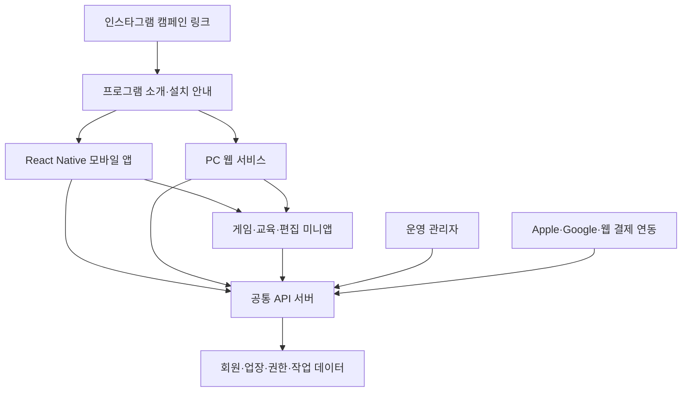

# 서린툴 · SEOLIN TOOL

**태권도 지도진을 위한 게임·교육·편집 도구 미니앱 플랫폼.**

서린태권도가 제작한 프로그램을 하나의 서비스에서 발견하고, 체험하고, 구독해 사용하는 플랫폼을 만든다. 모바일 앱과 PC 웹에서 같은 계정으로 이용하며, 유료 이용자는 자신의 업장 로고와 정보를 프로그램에 적용한다.

- 서비스명: **서린툴 / SEOLIN TOOL**
- 저장소: **seolin-tool-platform**
- 제작·운영 브랜드: **서린태권도**
- 배포 목표: **Android / iOS / PC 웹**
- 주력 언어: **TypeScript**
- 문서 기준일: **2026-10-15**

## 현재 구현 · 0.1.0 개발 버전

Expo / React Native / TypeScript로 **모바일 플랫폼과 수업용 미니앱 6종**을 연결했다.

- 홈·미니앱·내 앱·마이, 검색·카테고리, 앱별 상세·내 앱 보관함
- 진입 타이포, 실제 로고·설명·준비 경로를 갖춘 오늘의 게임, 큰 이미지 카테고리 4종
- O/X 문제 편집·텍스트 일괄 추가, 수업 한 세트와 설정의 기기 저장
- 1~60초 카운트, 수동/자동 정답 공개·진행, 일시정지·이전 문제·종료
- O/X 실시간 카메라 배경·좌우 O/X 무대·문제판, 전후면·반전, 카메라 없이 진행
- 가상격파·무궁화꽃이 피었습니다·초성퀴즈·끝말잇기 배틀·메모리 배틀: 원본 엔진·설정·점수판을 번들 HTML로 보존하고 새 로고·앱 진입 화면 적용
- 네이티브 음성 인식·읽어주기·사진 선택 연결, 공유 팀 점수·설정의 기기 저장
- 가로 화면·화면 꺼짐 방지, 종료·백그라운드 시 카메라·음성 해제

```sh
pnpm install --frozen-lockfile
pnpm dev      # Expo 모바일 개발 서버
pnpm web      # 화면 검증용 브라우저 미리보기
pnpm check    # 타입 검사 및 단위 테스트
pnpm export   # Android / iOS / Web JS 번들
```

Node.js 22.13 이상(검증 기준 24) / pnpm 11.25.0. [실행 안내](docs/mobile-development.md), [미니앱별 기능과 기기 연결](docs/live-games.md), [검증 기록](docs/first-release-checklist.md)을 참고한다. 네이티브 음성 인식은 해당 모듈을 포함한 개발 빌드가 필요하다.

회원·서버·구독·도장 로고 교체·리뷰 작성·실시간 순위·PC 편집 서비스는 아직 구현하지 않았다. JS 번들 생성은 APK/IPA 빌드나 실기기 검증과 다르다. 원본 기능 보존과 자동 검사는 완료했으며 카메라·음성·사진·TV 미러링의 실기기 검증은 남아 있다. **아래 내용은 장기 목표 설계**다.


## 1. 서비스 목표와 운영 방식

기존에는 개별 HTML 프로그램을 인스타그램에서 홍보하고 댓글 참여자에게 파일을 전달했다. 서린툴에서는 프로그램 소개·배포·사용 안내·회원·업장 브랜딩·이용 권한·구독을 통합 관리한다.

### 사용자 흐름

1. 인스타그램에서 신규 프로그램이나 이벤트를 발견한다.
2. 전달받은 프로그램별 캠페인 링크를 연다.
3. 신규 사용자는 플랫폼 앱 설치·가입·첫 사용 안내를 거친다.
4. 기존 사용자는 해당 미니앱으로 이동한다. 플랫폼 업데이트가 필요한 경우 스토어 업데이트를 안내한다.
5. 프로그램을 내 앱에 추가하고 무료 공개 또는 체험 조건에 따라 사용한다.
6. 체험 종료 후에는 Basic·Pro 또는 유효한 이벤트 혜택에 따라 계속 이용한다.
7. PC 지원 프로그램은 웹에서 같은 계정과 이용 권한으로 사용한다.

인스타그램 댓글 보상·코드 이벤트는 운영 후보이며 아직 확정하지 않았다. 자동 댓글 확인·메시지 발송 연동도 별도 후속 범위다.

### 기존 앱과의 관계

JUMPROPE PLAYER, BLOG COVER MAKER, TCON Maker의 기존 독립 앱은 별도 제품으로 유지한다. 이 저장소는 신규 플랫폼과 플랫폼에 등록할 미니앱을 관리한다. 기존 독립 앱을 편입·재구현하거나 플랫폼 구독과 연결하는 작업은 별도로 결정한다.

기존 HTML 프로그램은 재사용을 우선 검토하고, 공통 로그인·브랜딩·저장·권한 확인을 연결한다. 모든 프로그램을 React로 일괄 재작성하는 것을 전제로 하지 않는다.

## 2. 브랜드와 업장 정보

| 구분 | 예시 | 적용 위치 |
| --- | --- | --- |
| 서비스 브랜드 | 서린툴 / SEOLIN TOOL | 앱 아이콘, 로그인, 홈, 구독 안내 |
| 제작자 | 서린태권도 | 미니앱 소개·제작자 정보 |
| 기본 브랜딩 | 서린태권도 로고·정보 | 기본 미니앱 화면·출력물 |
| 유료 이용자의 브랜딩 | 이용자 업장의 이름·로고·연락처·색상 | 브랜딩을 지원하는 미니앱 화면·출력물 |

- 무료 이용에는 서린태권도 기본 브랜딩을 적용한다.
- 유료 이용자는 자신의 업장 로고·정보로 교체할 수 있도록 설계한다.
- 업장 정보가 없으면 서린태권도 기본값을 적용한다.
- 기본 로고를 각 HTML에 고정하지 않고 공통 브랜딩 설정으로 전달한다.
- 프로그램별 브랜딩 지원 범위를 기록한다. 저장·출력 시점의 브랜딩을 결과물에 반영한다.
- 구독 만료 후 기본 브랜딩 복귀 범위와 기존 결과물 처리 정책은 출시 전에 확정한다.

회원은 로그인 주체, 업장은 로고·설정·작업 자료의 소유 공간으로 구분한다. 향후 지도진 초대를 위해 소속과 역할을 별도로 관리한다. 초기 구독의 과금 단위가 개인인지 업장인지, 업장 구독에 몇 명이 포함되는지는 미정이다.

## 3. 전체 구조와 기술 방향



| 구성 | 제안 기술 | 역할 |
| --- | --- | --- |
| 모바일 플랫폼 | React Native + Expo + TypeScript | Android·iOS 공통 화면, 미니앱 실행, 계정·구독 |
| PC 웹·소개 페이지 | React 기반 + TypeScript | 설치 안내, 미니앱 탐색, PC 편집기, 내 작업 |
| 미니앱 | 기존 HTML/JavaScript 또는 React + Vite + TypeScript | 개별 게임·교육·편집 기능 |
| 모바일 미니앱 실행 | react-native-webview | 웹 프로그램 실행·탐색·복귀 |
| 공통 서버 | Node.js + NestJS + TypeScript | 회원, 업장, 목록, 권한, 체험, 구독, 캠페인 |
| 데이터베이스 | PostgreSQL | 회원·업장·서비스의 관계 데이터 |
| 파일 저장 | 객체 저장소 | 로고, 이미지, 프로그램 에셋·작업 파일 |
| 운영 관리자 | React + TypeScript | 프로그램·버전·회원·혜택·요금제·통계 관리 |

서버는 초기에는 하나의 배포 단위로 운영하고 내부 기능을 모듈로 나눈다. 모바일·웹·미니앱은 데이터 형식·공통 로직·디자인 기준을 공유하되, React Native 화면과 웹 화면은 각 실행 환경에 맞게 구현한다. 호스팅·인증·결제 공급업체와 버전은 구현 단계에서 선정한다.

## 4. 주요 화면

| 메뉴 | 내용 |
| --- | --- |
| 홈 | 신규 프로그램, 추천, 공지·이벤트, 최근 사용 |
| 둘러보기 | 카테고리, 검색, 인기차트, 프로그램 소개 |
| 내 앱 | 추가한 프로그램, 체험 상태, Basic 선택 앱, 잠긴 앱 |
| 마이 | 계정·내 업장·로고, 요금제, 설정, 문의, 계정 삭제 |

초기 카테고리는 **게임 / 교육 / 편집 / 수업·업무 도구**를 제안한다. 운영자가 카테고리·표시 순서·태그를 변경할 수 있도록 데이터로 관리한다.

### 내 앱과 인기차트

- **내 앱 추가**, **현재 이용 권한**, **Basic 선택**, **오프라인 다운로드**를 서로 다른 상태로 관리한다.
- 체험이 종료된 프로그램도 내 앱과 작업 기록에 남기고 잠금·재이용 방법을 표시한다.
- 오프라인 다운로드는 후속 검토 기능이다. 내 앱 추가가 파일 다운로드나 영구 이용권 획득을 뜻하지 않는다.
- 인기차트는 초기안으로 최근 24시간·7일의 중복을 줄인 실제 이용자 수를 사용한다.
- 새로고침·반복 실행으로 순위가 과도하게 오르지 않도록 집계한다. 초기 갱신 간격은 5분을 제안하고 마지막 갱신 시각을 표시한다.
- 순위 계산식·최소 이용 조건·집계 주기는 출시 전에 확정한다. 카메라·음성 원본을 순위 산정 자료로 수집하지 않는다.

## 5. 요금제와 이용 권한

| 플랜 | 월 요금 | 목표 이용 범위 |
| --- | ---: | --- |
| Free | 0원 | 무료 공개 프로그램과 유효한 무료 체험 |
| Basic | 9,900원 | 선택한 N개 프로그램 이용. N은 3~5개 중 추후 확정 |
| Pro | 19,900원 | 플랫폼의 전체 구독 대상 프로그램 이용 |

월 요금은 확정한 기획 기준이다. 세금 포함 여부·스토어별 판매 가격·연간 결제·업장 인원수는 별도 확정한다. Pro의 전체 범위는 플랫폼에 구독 대상으로 등록한 프로그램을 뜻하며, 별도 판매 중인 기존 독립 앱의 이용권을 자동으로 포함하지 않는다.

### 무료 공개·체험

미니앱별 정책에서 다음 방식을 지원한다. 실제 기간·적용 방식은 미정이다.

| 방식 | 기준 |
| --- | --- |
| 개인별 체험 | 해당 회원이 미니앱 체험을 시작한 시점부터 일정 기간 |
| 출시 이벤트 | 운영자가 지정한 종료 날짜까지 |
| 상시 무료 | 해당 프로그램을 계속 무료로 공개 |

- 체험 시작 전에 기간과 종료 조건을 안내한다.
- 시작·종료 시각은 서버에 기록하고 재설치·기기 변경·내 앱 삭제로 초기화하지 않는다.
- 체험 종료 시 자동 결제 없이 이용 권한을 잠그는 방식을 기본 제안으로 둔다. 유료 구독은 별도 동의로 시작한다.
- 이용 중 체험이 만료될 때 수업 중단을 어떻게 처리할지는 별도로 정한다.

### Basic 선택 규칙

- 앱 개수는 고유한 미니앱 상품 ID 기준으로 계산한다.
- LIVE GAME의 6개 게임을 하나의 프로그램으로 판매하면 Basic 1개로 계산하는 안을 제안한다. 분리 판매 여부는 미정이다.
- 무료·유효한 체험 앱은 Basic 선택 개수에서 제외하는 안을 제안한다.
- 선택 앱을 언제·몇 번 교체할 수 있는지 확정한다. 다음 결제 기간부터 교체하는 방식을 우선 검토한다.
- Pro에서 Basic으로 변경할 때 적용 시점 전에 유지할 앱을 선택하도록 설계한다.
- 구독 취소, 유효기간 만료, 환불, 유예 기간을 별도 상태로 처리한다. 단순 취소 요청과 즉시 권한 종료를 같은 것으로 취급하지 않는다.

### 공통 권한 판정

서버가 계정·업장 범위와 프로그램 공개·지원 상태를 먼저 확인한 뒤, 상시 무료·유효한 체험·유효한 혜택·Pro·Basic 선택 중 적용 가능한 권한을 판정한다. 실행 가능 여부와 근거·만료 시각을 모바일·웹에 동일하게 제공한다.

- 화면에 자물쇠를 표시하는 것만으로 권한을 관리하지 않는다. 저장·불러오기·내보내기 등의 보호된 API도 권한을 확인한다.
- 잠금은 작업 데이터 삭제와 구분한다. 보존 기간과 만료 후 열람·내보내기 범위는 별도 확정한다.
- 브랜딩 교체 권한도 공통 서버에서 관리한다.

## 6. 인스타그램 유입·링크·이벤트

프로그램별 캠페인 링크에 대상 프로그램, 캠페인, 안내 화면, 최소 플랫폼 버전 정보를 연결한다.

| 접속 상태 | 목표 동작 |
| --- | --- |
| 모바일 앱 미설치 | 프로그램 소개 → 스토어 설치 → 가입·사용 안내 |
| 모바일 앱 설치·호환 | 해당 프로그램 소개 또는 실행 화면 열기 |
| 플랫폼 버전 미지원 | 업데이트 이유·스토어 이동 안내 |
| PC 접속·PC 지원 | 웹 실행 또는 편집기 안내 |
| 이벤트 참여 | 로그인·대상 확인 → 유효한 혜택 안내·적용 |

Universal Links·App Links를 사용한다. 인스타그램 내장 브라우저와 외부 브라우저 동작도 검증한다. 설치 전 클릭 정보를 설치 후 자동 복원하는 기능은 별도 구현·검증 대상이며, 링크 재열기·로그인 후 이벤트 조회 같은 대체 진입도 준비한다.

새 미니앱이 기존 실행 환경과 호환되면 서버에서 게시하고 홈·공지·동의한 알림으로 안내한다. 새 네이티브 기능이 필요하면 플랫폼 앱 업데이트를 제출한다. 프로그램 버전과 최소 플랫폼 버전, 지원 SDK 버전을 구분해 관리한다.

댓글 참여에 따른 무료 이용 코드·체험 연장은 **미확정 운영 후보**다. 캠페인 대상·기간·중복 참여·사용 한도·적용 이력을 저장할 수 있게 설계하되, 유료 기능을 임의 코드로 해제하는 방식을 확정하지 않는다. Apple·Google 공식 제공 코드·프로모션과의 연결을 우선 검토한다.

## 7. 미니앱 실행·브랜딩·저장

### 미니앱 등록 정보

고유 ID, 이름, 아이콘, 설명, 카테고리·태그, 제작자, 실행 주소, 배포 버전, 지원 기기, 최소 플랫폼·SDK 버전, 무료·체험 정책, 필요한 데이터·기능, 브랜딩 지원 범위, 게시 상태를 관리한다.

### 공통 SDK

미니앱 SDK는 플랫폼 연결을 표준화한다.

- 미니앱에 한정된 로그인·권한 연결
- 동의한 범위의 업장 브랜딩 전달
- 프로그램별 작업 저장·불러오기
- 공통 오류·안내·실행 상태 처리
- 웹과 모바일 실행 환경 구분

미니앱에는 플랫폼 전체 로그인 토큰이나 다른 미니앱의 자료를 전달하지 않는다. 서버에서 회원·업장·미니앱별 접근 범위를 검증하고, 모바일 실행 환경에서는 허용된 주소·요청 형식만 처리한다.

카메라·마이크·파일·결제 등 기기 기능은 별도 설계·정책 확인 대상이다. Apple 심사 지침 4.7의 네이티브 API 노출·데이터 공유 조건을 확인한 뒤 연결 범위를 정한다.

### LIVE GAME 적용 후보

기존 LIVE GAME에는 OX 퀴즈, 가상 격파, 무궁화 꽃이 피었습니다, 초성 퀴즈, 끝말잇기 배틀, 메모리 배틀이 포함된다. 초기 대표 프로그램으로 검토한다.

카메라·마이크·음성 인식·전체화면·팀 점수판·기존 저장 방식이 Android·iPhone·PC에서 동작하는지 먼저 검증한다. PC 브라우저에서 동작한 기능이 모바일 WebView에서도 동일하게 동작한다고 가정하지 않는다.

기존에 전달한 독립 HTML 파일은 새 구독 정책으로 소급 잠그기 어렵다. 플랫폼 제공 버전은 서버 권한 확인을 연결한다. 브라우저에 전달되는 코드의 완전한 복제 방지를 보장하지 않으며, 오프라인 이용 시 권한 재확인 주기는 별도로 설계한다.

## 8. PC 웹 서비스

- 모바일과 같은 계정·업장·이용 권한을 사용한다.
- 미니앱별 지원 범위를 모바일·PC·양쪽으로 표시한다.
- PC 전용 편집기는 모바일에서 소개·내 앱 추가·PC 이용 안내를 제공한다.
- 공통 문서 형식과 저장 API를 사용하는 프로그램은 기기 간 작업 이어하기를 지원한다.
- 카메라·음성·대용량 편집·출력은 실제 지원 브라우저와 기기에서 검증한다.
- PC 웹 결제와 모바일 구독의 권한 연결을 설계하되 스토어별 결제·외부 링크 조건을 따른다.

## 9. 결제·관리자·데이터

### 결제

iOS는 Apple 인앱결제, Android는 Google Play Billing을 기본안으로 두고 PC 웹 결제는 후속 연결한다. 결제 사실은 서버에서 검증하고, 갱신·만료·환불·구매 복원 알림을 공통 권한으로 반영한다. 같은 구매를 여러 계정·업장에 중복 귀속하지 않도록 처리한다.

### 관리자

- 미니앱·카테고리·지원 기기·버전 등록과 게시·중지
- 체험 정책·출시 무료 기간·요금제 설정
- 프로그램 버전 전환·이전 버전 복구와 변경 이력
- 캠페인·혜택·사용 이력 관리
- 회원·업장·구독 상태와 문의 확인
- 실제 이용 통계·인기차트·오류 확인

### 주요 데이터 영역

| 영역 | 주요 데이터 |
| --- | --- |
| 회원·업장 | 회원, 업장, 소속·역할, 업장 브랜딩 |
| 프로그램 | 미니앱, 카테고리, 릴리스, 지원 환경 |
| 이용 | 내 앱, 체험, Basic 선택 목록, 작업 문서 |
| 구독·권한 | 플랜, 구매·구독 상태, 유효 권한, 검증·알림 이력 |
| 홍보 | 캠페인, 참여·혜택 적용 이력 |
| 운영 | 최소한의 이용 이벤트, 순위 집계, 오류·운영 변경 이력 |

이는 개념 모델이며 최종 DB 테이블·API 명세가 아니다. 외부 결제 알림은 중복·순서 변경을 고려해 처리하고, 계정 삭제·자료 보존·권한 만료를 구분한다.

## 10. 목표 저장소 구조

아래는 구현 단계에서 만들 구조다. 현재 이 디렉터리와 앱 코드가 모두 존재하는 것은 아니다.

```text
seolin-tool-platform/
├── apps/
│   ├── mobile/              # Android·iOS 플랫폼
│   ├── web/                 # 소개·설치 안내·PC 서비스
│   ├── admin/               # 운영 관리자
│   └── api/                 # 공통 서버
├── miniapps/
│   ├── live-game/           # 기존 프로그램 연결·개선 후보
│   └── .../                 # 추가 프로그램
├── packages/
│   ├── miniapp-sdk/         # 미니앱 연결 도구
│   ├── contracts/           # 공통 데이터·통신 규칙
│   ├── branding/            # 업장 정보 적용
│   ├── design-tokens/       # 색상·글꼴·간격
│   └── web-ui/              # 웹·미니앱 공통 화면 요소
├── docs/                    # 서비스·개발·운영 문서
├── infra/                   # 배포 설정
├── .github/                 # 이슈·PR 양식·자동 검증
├── AGENTS.md                # Git·이슈 작업 규칙
└── README.md
```

하나의 저장소에서 관리하되 모바일·웹·서버·미니앱은 각각 배포할 수 있게 구성한다. 새로운 프로그램을 추가할 때 플랫폼 코드를 반복 수정하기보다 등록 정보와 공통 SDK로 연결한다.

## 11. 개발 순서

아래 단계는 계획이며 실제 완료 전까지 체크하지 않는다.

| 단계 | 작업 | 완료 기준 |
| --- | --- | --- |
| 1. 정책·첫 출시 범위 | 미니앱 단위, 체험, Basic 선택 규칙, 과금 단위, 브랜딩 정의 | 구현에 필요한 정책과 미정 사항 구분 |
| 2. 실행 구조 검증 | LIVE GAME을 Android·iPhone·PC에서 검증 | 카메라·음성·전체화면·저장·복귀의 지원 범위 확인 |
| 3. 기반 프로젝트 | 모바일·웹·서버·공통 패키지, 개발·검증·운영 환경 구성 | 각 환경에서 기본 실행·배포 확인 |
| 4. 회원·업장·권한 | 로그인, 업장 정보, 자료 접근, 체험 시작·종료 | 다른 사용자 자료 접근 차단·재설치 시 체험 유지 |
| 5. 플랫폼·관리자 | 홈·탐색·소개·내 앱·마이, 프로그램 등록·게시 | 프로그램 발견→실행→복귀 흐름 완성 |
| 6. 대표 미니앱 | LIVE GAME 연결, 브랜딩, 필요한 작업 저장 | 실제 지도진이 수업에서 사용하고 오류 확인 |
| 7. 인스타 진입 | 캠페인 링크, 설치·첫 사용·업데이트 안내 | 신규·기존 사용자와 인스타 내장 브라우저 흐름 검증 |
| 8. 구독·PC 권한 | Basic·Pro, 선택 앱, 갱신·만료·환불·구매 복원 | 모바일·PC에서 동일 계정 권한 일치 |
| 9. 운영·출시 | 기본 인기차트, 통계, 버전 복구, 스토어 자료·테스트 | 사전 테스트 후 Android·iOS 정식 제출 |
| 10. 확장 | 미니앱 추가, PC 편집기, 혜택, 지도진 초대 | 우선순위에 따라 기능별 검증·배포 |

첫 출시의 목표 흐름은 **가입 → 기본 브랜딩으로 체험 → 내 앱 보관 → 체험 종료 → 구독 → 업장 로고 적용**이다. PC 지원 프로그램은 같은 권한을 확인한다. 최소 한 개의 대표 미니앱을 끝까지 연결한 뒤 다른 프로그램을 같은 규칙으로 추가한다.

### 배포 방향

- 플랫폼 앱은 Google Play·App Store에 각각 빌드·테스트·제출한다.
- 미니앱·PC 웹·서버는 별도로 배포하고 구버전 플랫폼과의 호환성을 확인한다.
- 미니앱 추가·업데이트도 스토어 정책 적용 대상이며 무조건 무심사 변경이 가능한 것으로 취급하지 않는다.
- 테스트 배포는 Google Play 테스트 트랙과 TestFlight를 사용한다.
- 출시 시점의 스토어 정책·필수 SDK·계정별 테스트 요구사항을 다시 확인한다.

### 후순위 검토

커뮤니티는 장기 검토 범위다. 수업 활용 사례·프로그램 사용법 공유부터 검토하고, 운영·신고·관리 부담과 실제 수요를 확인한 뒤 구현 여부를 정한다. 외부 개발자 입점과 오프라인 다운로드도 초기 필수 범위에 포함하지 않는다.

## 12. 출시 전에 확정할 사항

- [ ] Basic 선택 앱 수: 3개·4개·5개 중 결정
- [ ] 체험 기간·기준과 체험 중인 수업의 만료 처리
- [ ] Basic 앱 교체 시점·횟수와 Pro→Basic 전환 규칙
- [ ] 구독의 개인·업장 단위, 포함 지도진 수·동시 이용 범위
- [ ] 유료 브랜딩 지원 범위·만료 후 처리
- [ ] 구독·체험 만료 후 작업 열람·내보내기·보존 기간
- [ ] LIVE GAME 묶음 또는 게임별 판매 단위
- [ ] 가격의 세금·스토어별 표기, 연간 요금제 도입 여부
- [ ] 댓글 참여·코드 혜택의 방식과 스토어별 제공 수단
- [ ] 초기 지원 기기·브라우저·PC 전용 프로그램
- [ ] 인기차트 집계 기준·주기와 필요한 이용 데이터
- [ ] 인증·호스팅·파일 저장·결제 공급업체

## 13. Git 작업 규칙

상세 기준과 이슈 양식은 [AGENTS.md](AGENTS.md)에 기록한다.

- 태그: `init`, `feat`, `fix`, `docs`, `setting`, `add`, `refactor`, `chore` 중 소문자
- 커밋 제목: `[태그] 한글 작업 내용`, 50자 이내의 명령조
- 브랜치: `태그/#이슈번호-작업하는파일`
- 이슈를 먼저 만들고 실제 발급 번호로 본문을 갱신한 뒤, `develop`에서 작업 브랜치를 만든다.
- 작업 브랜치에 최신 `develop`을 병합하고 충돌·검증 결과를 확인한다.
- PR 대상은 `develop`이며, 세부 커밋을 보존하는 **merge commit** 방식으로 통합한다.
- `main`은 출시용, `develop`은 개발 통합용이다.
- 빈 저장소의 최초 커밋은 프로젝트 설정 브랜치에서 만들고 `main`·`develop`의 공통 기준점으로 설정한다. 이후 변경은 PR로 통합한다.
- 이슈 제목과 본문 첫 제목을 일치시키고 **브랜치 → 작업 목적 → 주요 작업 내용 → 완료 기준** 순서를 지킨다.
- 확인한 항목만 완료 체크한다. 검증 절차 작성과 실제 현장·기기 검증을 구분한다.

## 14. 공식 참고 문서

- [React Native와 TypeScript](https://reactnative.dev/docs/typescript)
- [Expo WebView](https://docs.expo.dev/versions/latest/sdk/webview/)
- [Expo 앱 링크](https://docs.expo.dev/linking/into-your-app/)
- [Apple 미니앱 심사 지침 4.7](https://developer.apple.com/app-store/review/guidelines/#mini-apps-mini-games-streaming-games-chatbots-plug-ins-and-game-emulators)
- [Apple 결제 지침](https://developer.apple.com/app-store/review/guidelines/#payments)
- [Google Play 결제 정책](https://support.google.com/googleplay/android-developer/answer/9858738?hl=en)
- [Apple 제공 코드](https://developer.apple.com/help/app-store-connect/manage-subscriptions/set-up-subscription-offer-codes/)
- [Google Play 프로모션 코드](https://developer.android.com/google/play/billing/promo)
- [Google Play 구매 검증](https://developer.android.com/google/play/billing/security)
- [Apple 구독 서버 알림](https://developer.apple.com/documentation/appstoreservernotifications)

정책은 변경될 수 있다. 실제 결제·미니앱 기기 기능·프로모션 구현과 스토어 제출 전에 해당 공식 문서를 다시 확인한다.
